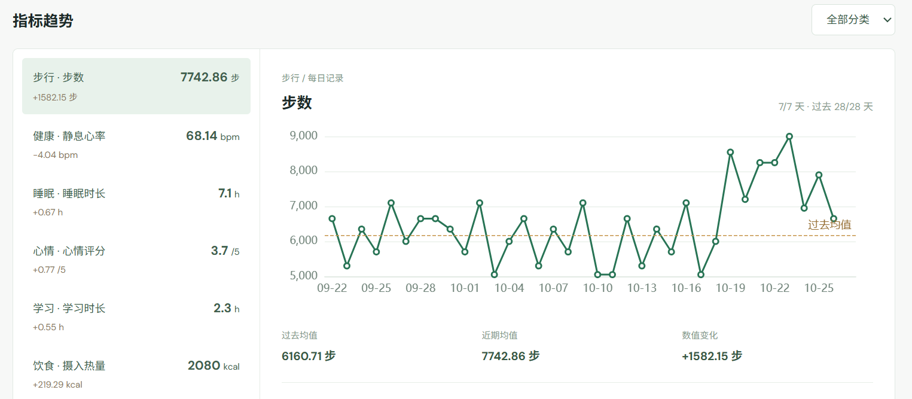
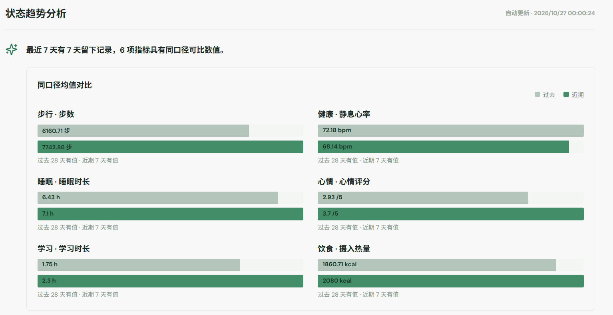

<p align="right"><strong>English</strong> · <a href="README.zh-CN.md">简体中文</a></p>

<p align="center">
  
</p>

<h1 align="center">PWS CC</h1>
<p align="center"><strong>Your growth, made visible.</strong></p>
<p align="center">Record · Reflect · Grow</p>
<p align="center"><a href="LICENSE"></a></p>

---

PWS CC brings conversations, daily records, reviews, and trends into a desktop web workspace. Edit your local files directly or talk to the assistant in the web app or through a connected WeChat account. Briefs and charts are built from what is already in your workspace.

## Quickstart

### 1. Clone and run

Requires Node.js 22.13+.

```powershell
git clone https://github.com/ravicc02/pws-cc.git
cd pws-cc/app
npm ci
npm run dev
```

Open `http://127.0.0.1:4317/`. Development mode starts both the web app and API; if a port is occupied, use the URL printed in the terminal. In **模型配置 (Model Settings)**, test and save a model connection before using **对话 (Chat)**. WeChat binding and the reminder, review, and brief schedules are optional and off by default.

### 2. Ask an agent to install it

Send this to an agent with access to a terminal on your computer:

```text
Install and start PWS CC for me from scratch:
1. Clone https://github.com/ravicc02/pws-cc.git. If the destination already exists, inspect its Git status first and do not overwrite my files.
2. Read README.md and AGENTS.md, check for Node.js 22.13+, then run npm ci and npm run dev inside app/. Keep the web and API processes running.
3. Check that the web home page and /api/state endpoint respond, then tell me the local URL or the exact startup error.
4. Guide me through testing and saving a model in the web UI. Let me decide whether to bind WeChat or enable scheduled messages. Do not create sample personal data, fabricate daily records, upload local data, or turn on messaging for me.
```

## Your growth, recorded.

Follow individual measures over time, then compare recent and earlier periods in the dashboard.



<sub>Metric trends · daily records and a historical baseline</sub>



<sub>State trend analysis · comparable metrics across two periods</sub>

## Workspace files

```text
pws-cc/
├── .gitignore
├── AGENTS.md
├── README.md
├── README.zh-CN.md
├── LICENSE
├── info.template.md               # Blank starter profile
├── info.md                         # Created locally when needed; not in the clone
├── templates/                      # Blank blueprints, never treated as user data
│   ├── info.md
│   ├── config/
│   │   ├── brief-template.md
│   │   └── daily-review-questions.json
│   ├── record/
│   │   ├── rute.md
│   │   └── daily.md
│   └── review/daily.md
├── record/
│   ├── .gitkeep
│   └── <category>/                 # Created locally after an actual report
│       ├── rute.md                 # Category rules
│       └── YYYY/MM/YYYY-MM-DD.md  # Facts by date
├── review/daily/
│   ├── .gitkeep
│   └── YYYY/MM/YYYY-MM-DD.md       # Created locally after a review answer
├── config/                         # Optional local brief and review settings
│   └── .gitkeep
├── docs/                            # Design notes and visual assets
└── app/
    ├── src/                         # Web console
    ├── server/                      # API, agents, WeChat, and scheduling
    ├── test/                        # Automated tests
    └── runtime/                     # Local settings, credentials, and sessions
```

- **`info.md`:** Stable personal information, preferences, and explicitly stated long-term goals. Created only after you provide them.
- **`info.template.md`:** A blank starter profile, not a personal profile.
- **`templates/`:** Blank blueprints for a profile, category rule, daily record, and daily review. They are not loaded as user data.
- **`templates/config/`:** Optional, generic brief and review-question settings to copy into local `config/` when desired.
- **`record/`:** Facts saved by topic and date. Categories grow from what you actually report; they are not pre-filled.
- **`rute.md`:** Each category's scope, optional fields, and confirmation rules for the agent, not a daily record.
- **`review/daily/`:** Your answers to daily review questions. A daily brief summarizes recorded facts and is not a review response.
- **`config/`:** Optional brief template and review questions; built-in defaults apply when custom files are absent.
- **`AGENTS.md`:** Internal instructions for workspace responsibilities, first use, selective retrieval, and record changes.
- **`app/src/`, `app/server/`, `app/test/`:** Web UI, backend, and tests; `docs/` holds design notes and brand assets.
- **`app/runtime/`:** Local model credentials, WeChat state, conversations, and analysis cache. Never committed to Git.
- **`README.md`, `README.zh-CN.md`, `LICENSE`, `.gitignore`:** Installation guides, the MIT license, and data-ignore rules.

A fresh clone has no `info.md`, records, or reviews, only empty directory placeholders. Personal data, records, reviews, local configuration, and runtime state are ignored by Git by default. Treat your own backups as private data.

## Sponsor

<table>
  <tr>
    <td><a href="https://sshzyu.com"></a></td>
  </tr>
</table>

## Star History

[](https://www.star-history.com/#ravicc02/pws-cc&Date)

---

<p align="center"><a href="LICENSE">MIT License</a> · © 2026 ravicc02</p>
